# Отчёт

## Таблица заданий и доказательств

  -------------------------------------------------------------------------------------------------------------------------
  Пункт задания                       Доказательства
  ----------------------------------- -------------------------------------------------------------------------------------
  Задание 1                           [Скриншот](assets/image.png)

  Задание 2                           [Скриншот 1](assets/image-1.png), [скриншот 2](assets/image-2.png), [скриншот
                                      3](assets/image-3.png), [скриншот 4](assets/image-4.png)

  Задание 3                           [Скриншот 1](assets/image-5.png), [скриншот 2](assets/image-6.png)

  Задание 4                           [Скриншот 1](assets/image-7.png), [скриншот 2](assets/image-8.png), [скриншот
                                      3](assets/image-9.png), [зелёный прогон с
                                      тестами](https://github.com/OlegGayvoronsky/churn-service/actions/runs/38867600215)

  Задание 5                           [Скриншот DAG --- сценарий 1](assets/image-10.png), [сценарий
                                      2](assets/image-11.png), [сценарий 3](assets/image-12.png), [после возврата валидных
                                      данных](assets/image-13.png), [Model Registry](assets/image-14.png),
                                      [дашборд](assets/image-15.png), [вывод генератора трафика во время
                                      выката](assets/image-16.png)

  Задание 6                           [Зелёный
                                      прогон](https://github.com/OlegGayvoronsky/churn-service/actions/runs/39033106626)
  -------------------------------------------------------------------------------------------------------------------------

## Схема системы

Всё работает внутри кластера `kind` (`churn-service`). Порт 80 хоста
ведёт в Traefik, все адреса `*.localhost` попадают туда же и разводятся
по имени хоста.

### Компоненты и их роли

  -----------------------------------------------------------------------
  Namespace               Компонент               Роль
  ----------------------- ----------------------- -----------------------
  `traefik`               Traefik                 Единственная точка
                                                  входа, маршрутизация по
                                                  Ingress (NodePort
                                                  30080)

  `mlops`                 MLflow                  Эксперименты и реестр
                                                  моделей, том
                                                  `mlflow-data` (SQLite +
                                                  файлы артефактов)

  `mlops`                 Airflow                 Оркестрация
                                                  переобучения (DAG
                                                  `churn_retrain`)

  `mlops`                 RustFS                  S3-хранилище данных
                                                  DVC, бакет `dvc`

  `monitoring`            Prometheus              Сбор метрик

  `monitoring`            Grafana                 Дашборды

  `default`               churn-service           `api` контейнер сервиса
                                                  на FastAPI (uvicorn,
                                                  порт 8000),
                                                  масштабируется через
                                                  HPA

  `default`               Postgres                БД `churn`, таблица
                                                  `predictions` (логи
                                                  запросов)

  вне кластера            GitHub Actions +        Тесты, сборка образа в
                          self-hosted runner      ghcr, деплой в kind
  -----------------------------------------------------------------------

### Порядок вызовов

``` text
Клиент ──> churn-service.localhost ──> Traefik ──> Service churn-service ──> под (api сервиса)
                                                                             │
                                     ┌───────────────────────────────────────┤
                                     ▼                                       ▼
                              Postgres (predictions)               /metrics, /health
                              запись в фоне                                ▲
                                                                           │
                                                 Prometheus (ServiceMonitor) ──> Grafana

Airflow DAG ──> под переобучения, образ из переменной churn_image
                  ├─ dvc pull ──> RustFS
                  ├─ проверка данных через Pandera
                  ├─ обучение CatBoost ──> MLflow
                  └─ сравнение по PR-AUC ──> при выигрыше ставится алиас champion

Разработчик: dvc push ──> s3.localhost ──> Traefik ──> RustFS
             git push ──> GitHub Actions ──> образ в ghcr ──> деплой на runner по кнопке ──> kind
```

1.  **Предсказание.** Запрос приходит в Traefik, затем в Service и под с
    API сервиса. Под считает score моделью с алиасом `champion`,
    отвечает клиенту и в фоне пишет строку в Postgres. Это касается и
    запросов с ошибкой 422.
2.  **Мониторинг.** Prometheus забирает `/metrics` у подов по
    ServiceMonitor. Grafana строит дашборд из Prometheus.
3.  **Переобучение.** Airflow запускает под с образом сервиса:
    `dvc pull` из RustFS, проверка данных через Pandera, обучение
    CatBoost, запись run в MLflow, сравнение по PR-AUC и перенос алиаса
    `champion`, если новая модель лучше. Чтобы поды сервиса начали
    использовать новую модель, их нужно перезапустить.
4.  **Данные.** `dvc push` отправляет файлы в RustFS через
    `s3.localhost`. В Git уходит только указатель `.dvc`.
5.  **CI/CD.** Workflow `ci`: тесты и `ruff` (на push и pull request),
    build образа (только на `main`), деплой (только по кнопке) на
    self-hosted runner.

## Кто что хранит

  -------------------------------------------------------------------------------------------------------------------------------------------------------------------------
  Что                     Где лежит                                           Как найти нужную версию
  ----------------------- --------------------------------------------------- ---------------------------------------------------------------------------------------------
  **Код**                 GitHub                                              Чтобы найти нужную версию, используется Commit SHA. `git checkout <sha>` возвращает код и
                                                                              версии зависимостей. SHA записан в теге образа.

  **Данные**              Файлы в бакете `dvc` в RustFS. В Git лежит только   Берём `.dvc` из нужного коммита и выполняем `uv run dvc checkout` или `dvc pull`. md5
                          `data/train.csv.dvc` с md5                          датасета сохранён в MLflow run.

  **Модель**              MLflow (`mlflow.localhost`) в томе `mlflow-data`:   Актуальную версию показывает алиас `champion`. Версию, запущенную в подах, видно в `/health`
                          метаданные в SQLite, файлы моделей в                в поле `model_version` и в метрике `churn_model_info`. Для воспроизведения открываем
                          `/mlflow/artifacts`                                 метаданные модели в run, находим параметры, md5 данных, SHA (при наличии).

  **Образ**               ghcr.io:                                            Версия определяется по SHA в теге. Чтобы понять, что запущено сейчас, нужно выполнить:
                          `ghcr.io/<репозиторий>:sha-<полный SHA коммита>`.   `kubectl get deploy churn-service -o jsonpath='{.spec.template.spec.containers[0].image}'`.
                          Внутри код, зависимости по `uv.lock`, указатели     CI переопределяет образ через `kubectl set image`.
                          `.dvc`                                              

  **Логи запросов**       Таблица `predictions` в БД `churn` в Postgres       
                          кластера.                                           
  -------------------------------------------------------------------------------------------------------------------------------------------------------------------------

## Задание 1

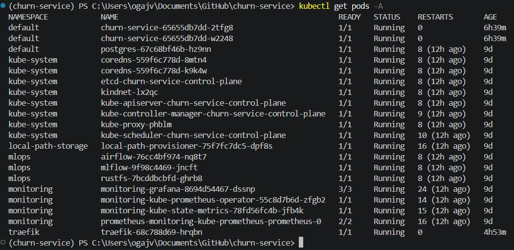

Чтобы поднять проект с нуля, ушло 45 минут.

## Задание 2

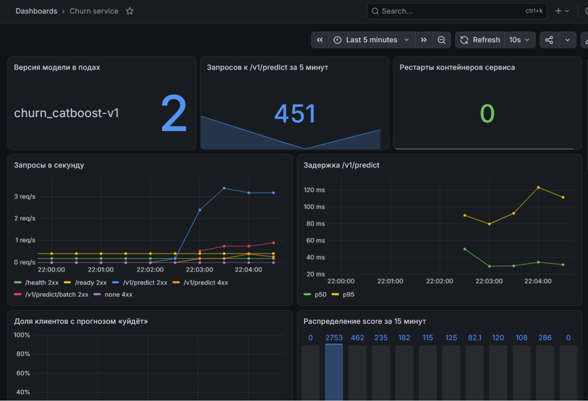

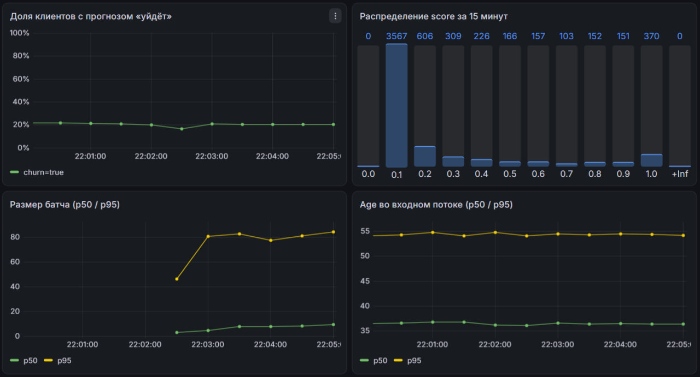

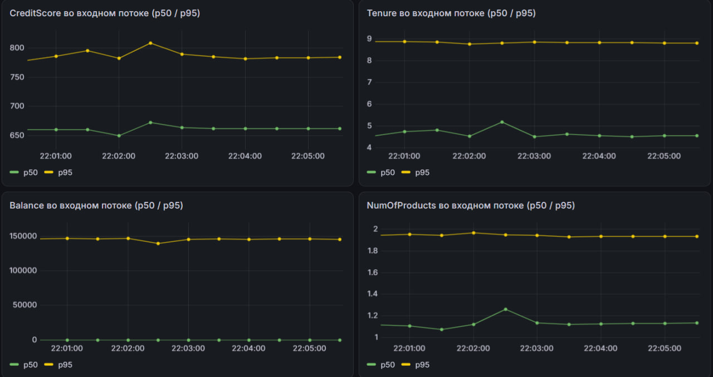

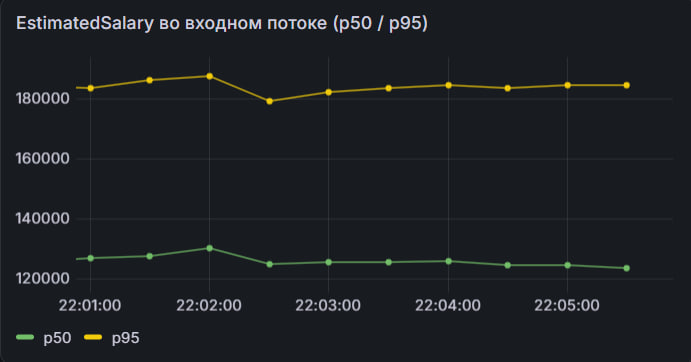

## Задание 3

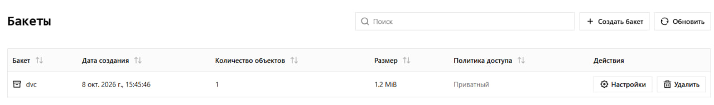

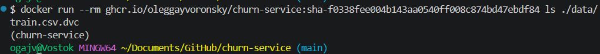

## Задание 4

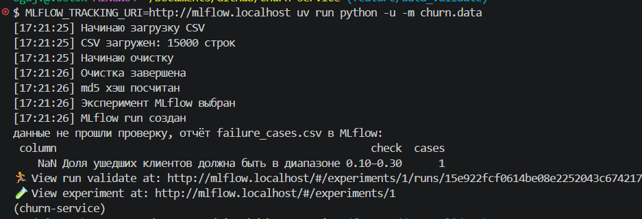

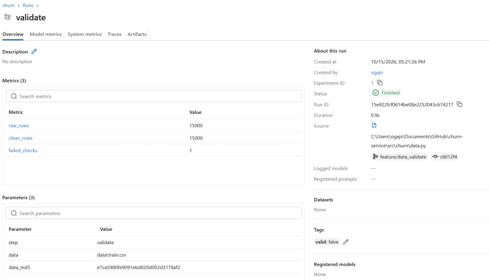

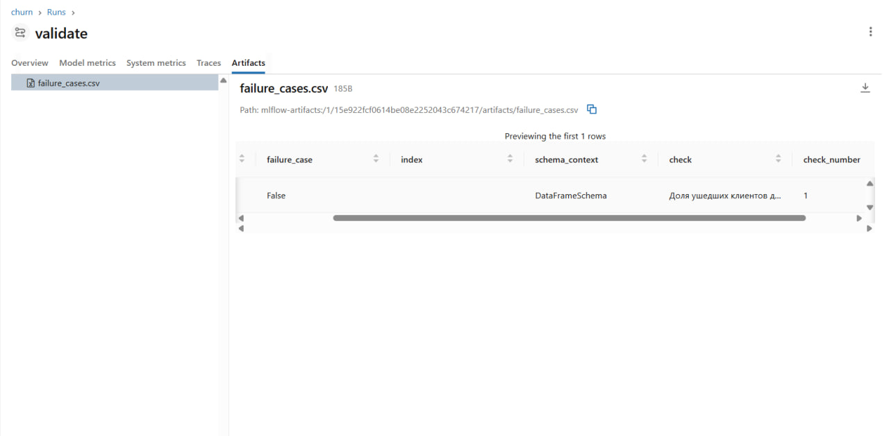

[Зелёный прогон с
тестами](https://github.com/OlegGayvoronsky/churn-service/actions/runs/38867600215)

Границы для доли ушедших пользователей подобрал, посчитав долю таргета
на тренировочном датасете, добавив к этому небольшой разброс для
естественных изменений таргета.

## Задание 5

Скрины DAG для 3-х сценариев:

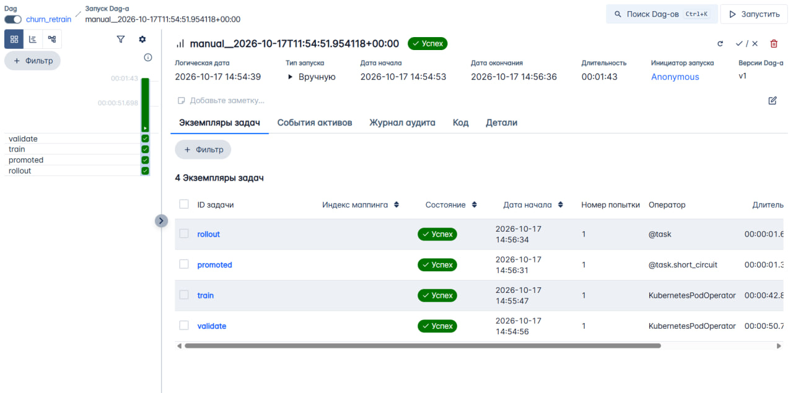

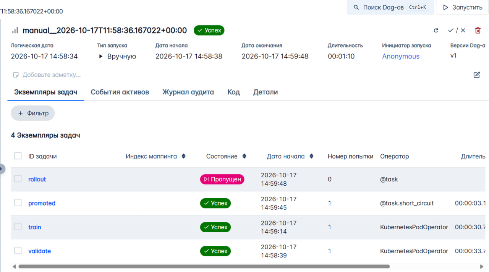

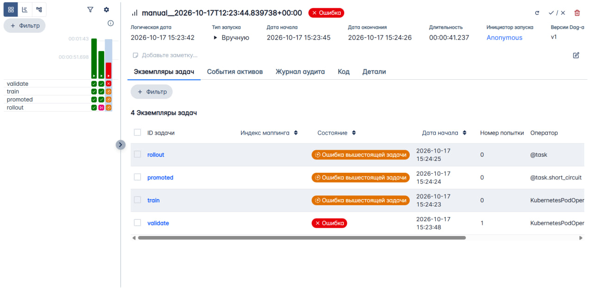

После возврата валидных данных:

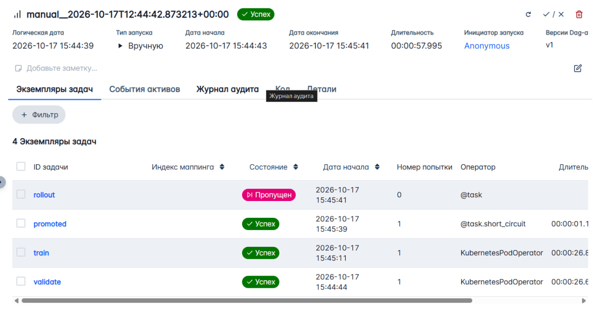

### Model registry

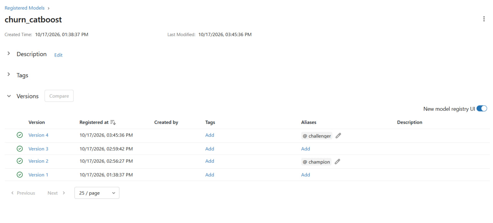

### Дашборд

Скрин дашборда с переключением версии и вывод генератора трафика за
время выката:

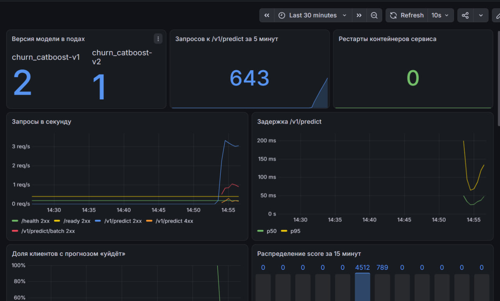

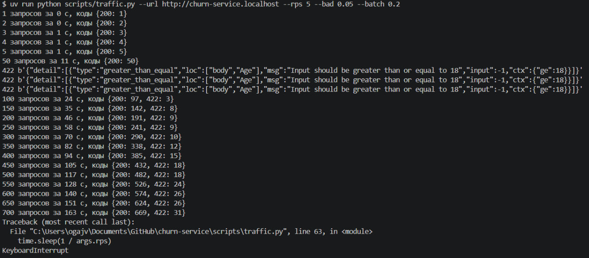

## Задание 6

[Зелёный
прогон](https://github.com/OlegGayvoronsky/churn-service/actions/runs/39033106626)

## Вопросы

### 1

Открываем нужный эксперимент и Run, связанный с версией модели.
Сохраняем `run_id`, `experiment_id`, параметры обучения, а также Git
commit SHA (при наличии, у меня не реализовано) и MD5 hash датасета.

Чтобы восстановить код, по SHA возвращаемся к нужной версии проекта,
включая `train.py`, `pyproject.toml` и `uv.lock`:

``` bash
git checkout <git commit>
```

Чтобы восстановить данные, используем соответствующие `.dvc`-файлы из
этого коммита:

``` bash
uv run dvc checkout
```

Затем нужно установить зависимости:

``` bash
uv sync --locked
```

Затем запускаем обучение с параметрами из MLflow, по аналогии с:

``` bash
MLFLOW_TRACKING_URI=http://mlflow.localhost uv run python -m churn.train
```

### 2

В образе храним только указатели на данные, потому что датасет может
быть тяжёлый. Кроме того, хранение данных через DVC позволяет
версионировать их отдельно от кода.

Если выполнить `git push` раньше `dvc push`, в Git появятся указатели на
данные, которых ещё нет в хранилище. При попытке скачать их через
`dvc pull` в поде возникнет ошибка, и обучение или валидация не смогут
выполниться.

Это будет видно в графе соответствующего DAG в Airflow на задаче
`validate`.

### 3

Бинарные проверки: уникальность id, отсутствие пропусков, допустимые
значения Geography и Gender, диапазоны CreditScore, Age, NumOfProducts,
Tenure, Balance, EstimatedSalary, Excited.

Проверки с порогом: минимум 10 000 строк в датасете и доля ушедших
клиентов Exited от 10% до 30%.

Чтобы подобрать пороги, смотрел на распределения параметров датасета.
По-хорошему, нужно смотреть на распределение признаков за всю историю по
собранным данным.

Если пороги слишком строгие, то валидные данные могут не пройти,
например, если распределение признака изменилось естественным путём.

### 4

Pandera проверяет валидность данных для обучения моделей. Pydantic-схема
проверяет валидность данных, приходящих на вход сервису. Нужны обе, так
как они проверяют данные на разных этапах.

### 5

Airflow предназначен только для того, чтобы оркестрировать задачи. Сам
процесс обучения выполняет под с образом сервиса, с тем же кодом и
зависимостями.

Выкатка новой модели не требует пересборки образа, потому что его код не
меняется. Меняется только чемпионский алиас в MLflow. Чтобы в подах
появилась новая модель, достаточно их перезапустить.

### 6

-   **Метрики про инфраструктуру:** рестарты контейнеров сервиса.
-   **Метрики про сервис:** версия модели в подах, запросы к
    `/v1/predict` за 5 минут, задержка `/v1/predict`, запросы в секунду,
    размер батча (p50 / p95).
-   **Метрики про модель:** распределение score за 15 минут, доля
    клиентов с прогнозом «уйдёт», распределение признаков.

`request_id` не стоит класть в метку Prometheus, так как данный параметр
имеет уникальное значение для каждого запроса. Из-за этого Prometheus
перегрузится.

### 7

Во время выката новой модели поочерёдно создаются новые и убиваются
старые поды, что соответствует стратегии Rolling Update. Благодаря этому
запросы продолжают обрабатываться во время обновления.

`preStop` позволяет поду перестать принимать запросы перед завершением и
завершить уже обрабатываемые. Без него, при остановке старых подов,
видели ошибки выполнения запросов.

### 8

Самый вероятный отказ --- дрейф модели. Первый сигнал этого можно будет
заметить при помощи мониторинга распределения доли клиентов с прогнозом
«уйдёт». Первое, что я сделаю --- сравню распределение ключевых
признаков в обучающих данных и запросах из таблицы по PSI. В случае
подтверждения существенного отклонения нужно будет проверить источник
данных, а также, при необходимости, откатить модель на предыдущую
версию. Когда появятся размеченные данные, запущу переобучение модели.

## Ошибки

1.  В функции `record_features` из `app.py` обрабатывал pydantic-модели,
    а не обычный dict. Поменял на обработку dict.
2.  В `dashboard.yaml` были проблемы с запятыми.
3.  Удалил директорию `data/` из `.dockerignore`, без этого Docker не
    собирался.

## Переделки

| Пункт обратной связи | Что сделано | Ссылка на коммит или прогон |
|---|---|---|
| На Windows Quickstart падал на шаге 4: у `platform/up.sh` могли быть окончания строк CRLF, из-за чего Bash выдавал ошибку `$'\r'`. | Добавлено правило `*.sh text eol=lf` в `.gitattributes`, чтобы Git сохранял окончания строк shell-скриптов в формате LF. | [Коммит `0d20666`](https://github.com/OlegGayvoronsky/churn-service/commit/0d20666d71f1a8fabe01d01bcd2b3e649a3832c2) · [Прогон GitHub Actions](https://github.com/OlegGayvoronsky/churn-service/actions/runs/40510008103) |
| В инструкции Quickstart отсутствовал шаг включения GitHub Actions в форке. | В Quickstart добавлен шаг: открыть вкладку **Actions** в своём форке и включить workflows. При необходимости нужно проверить разрешения в **Settings → Actions → General**. | [Коммит `e054183`](https://github.com/OlegGayvoronsky/churn-service/commit/e054183f8c4464dbd88539e26665a61f4091922c) |
| В `REPORT.md` не было сводной таблицы заданий со ссылками на доказательства. | В начало отчёта добавлена таблица для заданий 1–6 со ссылками на имеющиеся скриншоты и прогоны GitHub Actions. | [Коммит `e054183`](https://github.com/OlegGayvoronsky/churn-service/commit/e054183f8c4464dbd88539e26665a61f4091922c) |

